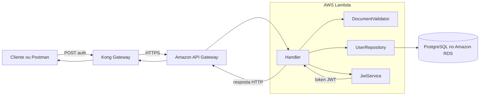
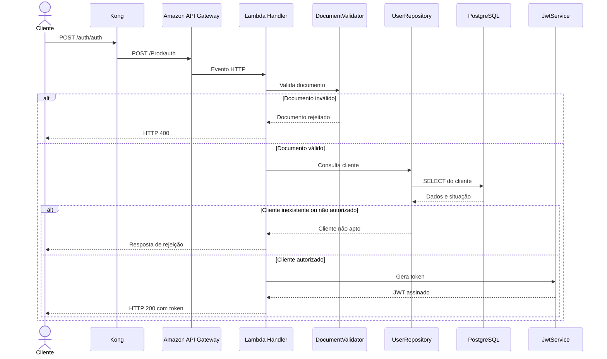

# Oficina360 - Lambda de Autenticação

Função serverless responsável pela autenticação da **Oficina360**, desenvolvida para a Fase 3 do Tech Challenge.

A solução recebe um documento de identificação, valida o formato, consulta o cliente no PostgreSQL e, quando o cliente está apto, emite um token JWT para acesso às rotas protegidas da aplicação principal.

## 1. Propósito do repositório

Este repositório contém a função AWS Lambda responsável pelo fluxo de autenticação da Oficina360.

As principais responsabilidades são:

- receber uma solicitação de autenticação por HTTP;
- validar o documento informado;
- consultar a existência e a situação do cliente no PostgreSQL;
- emitir um token JWT para clientes autorizados;
- retornar respostas HTTP padronizadas;
- empacotar e publicar a função com AWS SAM;
- executar testes unitários, cobertura, análise de qualidade e análise de dependências;
- automatizar validação e deploy com GitHub Actions.

Este repositório não provisiona o Amazon RDS, o Amazon EKS, o Kong ou a aplicação principal. Esses componentes são mantidos em repositórios independentes.

## 2. Tecnologias utilizadas

- Java
- Maven
- AWS Lambda
- Amazon API Gateway
- AWS Serverless Application Model
- PostgreSQL
- PostgreSQL JDBC Driver
- Auth0 Java JWT
- Jackson
- JUnit
- JaCoCo
- OWASP Dependency-Check
- SonarQube ou SonarCloud
- GitHub Actions
- Dependabot

## 3. Arquitetura específica do repositório



### Responsabilidade das classes

- **`Handler`**: ponto de entrada da Lambda e coordenador do fluxo de autenticação.
- **`AuthRequest`**: representa os dados recebidos na solicitação.
- **`AuthResponse`**: representa a resposta devolvida ao cliente.
- **`DocumentValidator`**: valida o documento informado.
- **`UserRepository`**: consulta o cliente no PostgreSQL.
- **`User`**: representa os dados do cliente consultado.
- **`JwtService`**: gera e configura o token JWT.

## 4. Fluxo de autenticação



## 5. Estrutura do repositório

```text
.
├── .github/
│   ├── dependabot.yml
│   └── workflows/
│       ├── sam.yml                 build e deploy com AWS SAM
│       ├── sonar.yml               análise de qualidade
│       └── teste.yml               testes e verificações automatizadas
├── docs/
│   ├── exemplo-debug-remoto.png
│   ├── oficina360-auth-lambda.postman_collection.json
│   └── rodar-local.md
├── src/
│   ├── main/java/com/techchallenger/oficina360/
│   │   ├── AuthRequest.java
│   │   ├── AuthResponse.java
│   │   ├── DocumentValidator.java
│   │   ├── Handler.java
│   │   ├── JwtService.java
│   │   ├── User.java
│   │   └── UserRepository.java
│   └── test/java/com/techchallenger/oficina360/
│       ├── DocumentValidatorTest.java
│       └── JwtServiceTest.java
├── .gitignore
├── pom.xml
├── README.md
└── template.yaml
```

> Os diretórios `.aws-sam/`, `target/` e `.idea/`, além do arquivo `.env`, são artefatos locais e não devem ser versionados.

## 6. Pré-requisitos

### Ferramentas

- Java compatível com a versão definida no `pom.xml`;
- Maven;
- AWS CLI;
- AWS SAM CLI;
- Docker, utilizado pelo SAM para execução local;
- Git.

### Verificar as instalações

```bash
java -version
mvn -version
aws --version
sam --version
docker --version
```

### Configuração AWS

A sessão da AWS deve possuir permissões para os recursos utilizados pelo `template.yaml`, incluindo Lambda, API Gateway, CloudFormation, IAM e acesso aos artefatos de deploy.

```bash
aws sts get-caller-identity
```

## 7. Configuração

A função utiliza variáveis de ambiente para configuração do banco e do JWT. Os nomes efetivos devem ser mantidos consistentes entre o código Java, o `template.yaml` e os workflows.

Configurações esperadas:

```text
DB_HOST
DB_PORT
DB_NAME
DB_USERNAME
DB_PASSWORD
JWT_SECRET
JWT_ISSUER
```

Exemplo de arquivo `.env` exclusivamente local:

```dotenv
DB_HOST=host.docker.internal
DB_PORT=5432
DB_NAME=oficina360
DB_USERNAME=oficina360_local
DB_PASSWORD=senha-local
JWT_SECRET=segredo-local-com-tamanho-adequado
JWT_ISSUER=oficina360-auth
```

O arquivo `.env` não deve ser enviado ao Git.

## 8. Execução local

Consulte também [`docs/rodar-local.md`](docs/rodar-local.md).

### 8.1 Compilar e testar

```bash
mvn clean verify
```

### 8.2 Gerar o pacote SAM

```bash
sam build
```

### 8.3 Iniciar a API local

```bash
sam local start-api --env-vars env.local.json
```

A API local fica disponível, por padrão, em:

```text
http://127.0.0.1:3000
```

### 8.4 Testar a autenticação local

```bash
curl --request POST \
  http://127.0.0.1:3000/auth \
  --header 'Content-Type: application/json' \
  --data '{"document":"25231015000191"}'
```

Utilize apenas documentos fictícios ou destinados a teste.

### 8.5 Executar a função diretamente

Crie um evento compatível com o tipo de integração definido no `template.yaml` e execute:

```bash
sam local invoke AuthFunction \
  --event event.json \
  --env-vars env.local.json
```

## 9. Testes e qualidade

### Testes unitários

```bash
mvn test
```

Os testes existentes cobrem, entre outros pontos:

- validação do documento;
- geração e validação do JWT.

### Verificação completa

```bash
mvn clean verify
```

### Relatório de cobertura

Após a execução, abra:

```text
target/site/jacoco/index.html
```

### Relatório de dependências

Quando o perfil correspondente estiver configurado no Maven, os relatórios ficam disponíveis em:

```text
target/dependency-check-report.html
target/dependency-check-report.json
```

### Análise Sonar

A análise automatizada é executada pelo workflow `.github/workflows/sonar.yml`. Tokens e identificadores da organização devem ser fornecidos por Secrets ou Variables do GitHub.

## 10. Deploy com AWS SAM

### 10.1 Validar o template

```bash
sam validate --lint
```

### 10.2 Compilar

```bash
sam build
```

### 10.3 Primeiro deploy guiado

```bash
sam deploy --guided
```

Durante o deploy guiado, revise:

- nome da stack;
- região AWS;
- parâmetros;
- permissões IAM;
- variáveis de ambiente;
- confirmação das alterações do CloudFormation.

### 10.4 Próximos deploys

Após a criação do arquivo de configuração do SAM:

```bash
sam build
sam deploy
```

### Deploy pelo GitHub Actions

1. Acesse a aba **Actions**.
2. Execute o workflow definido em `.github/workflows/sam.yml`.
3. Aguarde build, testes, empacotamento e deploy.
4. Confirme o status da stack e da função na AWS.
5. Consulte os logs da execução em caso de falha.

## 11. Validação do deploy

### Consultar a stack

```bash
aws cloudformation describe-stacks \
  --stack-name oficina360-auth-lambda \
  --query 'Stacks[0].{Status:StackStatus,Outputs:Outputs}' \
  --output json
```

### Consultar a função

```bash
aws lambda get-function-configuration \
  --function-name oficina360-auth-lambda \
  --query '{FunctionName:FunctionName,Runtime:Runtime,State:State,LastModified:LastModified}' \
  --output table
```

Caso o nome físico seja gerado pelo CloudFormation, obtenha o nome pelo output da stack ou pela lista de recursos:

```bash
aws cloudformation list-stack-resources \
  --stack-name oficina360-auth-lambda \
  --output table
```

### Consultar logs no CloudWatch

```bash
aws logs tail /aws/lambda/oficina360-auth-lambda \
  --since 10m \
  --follow
```

Ajuste o log group se a função possuir nome físico gerado pela stack.

## 12. API e Postman

### Contrato da API

O contrato da API serverless é definido no arquivo [`template.yaml`](template.yaml), que descreve a função e os eventos HTTP publicados pelo AWS SAM.

### Endpoint local

```text
POST http://127.0.0.1:3000/auth
```

### Endpoint publicado pela plataforma

```text
POST /auth/auth
```

A rota pública utiliza como base o hostname do Load Balancer do Kong. O Kong remove o primeiro prefixo `/auth` e encaminha a solicitação ao stage e à rota configurados no Amazon API Gateway.

### Corpo da requisição

```json
{
  "document": "25231015000191"
}
```

### Collection do Postman

A collection está disponível em:

[`docs/oficina360-auth-lambda.postman_collection.json`](docs/oficina360-auth-lambda.postman_collection.json)

A collection possui as variáveis:

- `baseUrl`, inicialmente configurada para `http://127.0.0.1:3000`;
- `authPath`, inicialmente configurada para `/auth`;
- `document`, com valor fictício para teste.

Para utilizar a rota pública do Kong, altere `baseUrl` para o endereço do Load Balancer e `authPath` para `/auth/auth`.

### Swagger

Este repositório utiliza o `template.yaml` como contrato versionado da API serverless. A implantação atual não depende de uma interface Swagger UI própria. A documentação interativa da API principal é mantida no repositório da aplicação Oficina360.

## 13. Pipelines

### `sam.yml`

Responsável pelo ciclo de build e deploy da solução serverless com AWS SAM.

### `teste.yml`

Responsável pelos testes unitários, cobertura e verificações automatizadas do projeto Java.

### `sonar.yml`

Responsável pela análise de qualidade do código e publicação do resultado no Sonar.

### `dependabot.yml`

Responsável por propor atualizações das dependências e dos componentes do GitHub Actions.

## 14. Segurança

- Não versione o arquivo `.env`.
- Não versione `.aws-sam/`, `target/` ou `.idea/`.
- Não registre JWT completo, CPF, CNPJ, senha ou `Authorization` nos logs.
- Armazene `JWT_SECRET` e credenciais do banco em Secrets.
- Utilize o mesmo `JWT_ISSUER` na Lambda e na API principal.
- Configure expiração para os tokens.
- Restrinja a conectividade do banco às origens autorizadas.
- Proteja a branch `main` contra commits diretos.
- Utilize Pull Requests e checks obrigatórios.
- Revogue imediatamente qualquer credencial exposta.

### Sugestão de `.gitignore`

```gitignore
.env
.env.*
!.env.example

.aws-sam/
target/
.idea/
.vscode/

*.log
.DS_Store
Thumbs.db
```

## 15. Destruição

Para remover a stack serverless:

```bash
sam delete --stack-name oficina360-auth-lambda
```

Ou pelo AWS CLI:

```bash
aws cloudformation delete-stack \
  --stack-name oficina360-auth-lambda

aws cloudformation wait stack-delete-complete \
  --stack-name oficina360-auth-lambda
```

A exclusão da stack remove os recursos gerenciados pelo CloudFormation. Recursos externos, como o Amazon RDS, não são removidos por este repositório.

## 16. Versionamento

O repositório utiliza Versionamento Semântico:

```text
vMAJOR.MINOR.PATCH
```

A primeira versão estável documentada é `v1.0.0`.

Consulte [`CHANGELOG.md`](CHANGELOG.md) para visualizar o histórico de alterações.

## 17. Repositórios relacionados

A solução Oficina360 é dividida em repositórios independentes para aplicação principal, autenticação serverless, infraestrutura Kubernetes e infraestrutura do banco. Os links oficiais devem ser mantidos na descrição da organização ou do projeto no GitHub.
